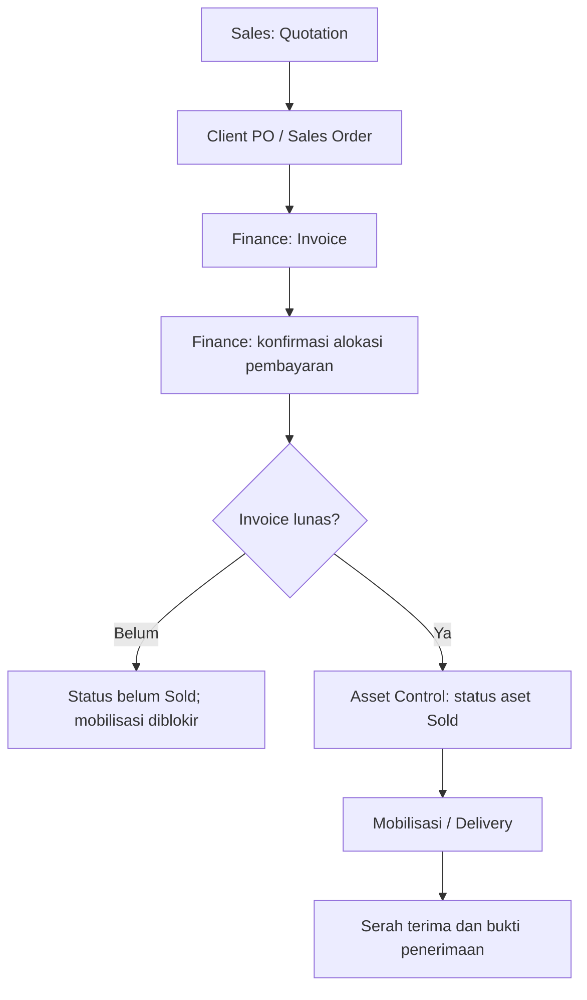
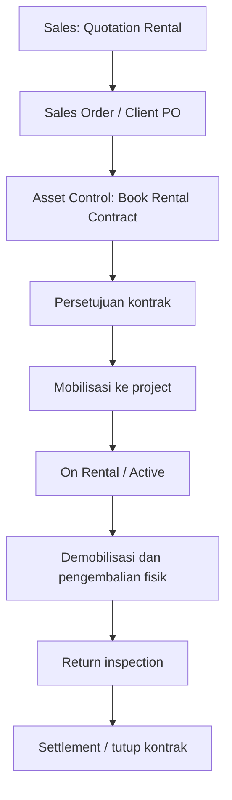

# EAMS — Revisi Alur Bisnis dan Operasional (Oktober 2026)

Dokumen ini melengkapi panduan EAMS sebelumnya. Source code ini tetap menggunakan Node.js + TypeScript + React/Vite dan penyimpanan database JSON di `data/eams_db.json`; ini bukan migrasi ke PostgreSQL.

## 1. Alur penjualan alat berat

- Quotation penjualan memilih unit dengan status `AVAILABLE`; biaya mobilisasi/pengiriman ditampilkan pada rincian quotation.
- Remarks quotation diteruskan ke Sales Order ketika quotation dikonversi.
- Sales Order yang dibatalkan membatalkan quotation terkait dan melepas reservasi aset jika masih `RESERVED`.
- Pembayaran harus dialokasikan dan invoice harus berstatus `PAID` sebelum aset dari Sales Order penjualan ditandai `SOLD` dan dapat dimobilisasi. Pembayaran sebagian tidak memenuhi syarat tersebut.
- Jika invoice sudah diterbitkan atau ada pembayaran, pembatalan Sales Order ditolak sampai invoice diselesaikan sesuai kontrol keuangan.

## 2. Alur rental alat berat

- Booking baru hanya dapat memakai unit yang benar-benar `AVAILABLE` atau unit yang telah dialokasikan secara valid untuk Sales Order terkait.
- Unit `RENTED` tidak dapat dialokasikan ulang. Upaya booking yang terdeteksi pada endpoint rental langsung ditolak dan menghasilkan notifikasi kepada Asset Control, Sales, Operasional, dan Manager. Unit harus melewati demobilisasi, pengembalian fisik, dan inspeksi sebelum dipakai kembali.
- Alur return/inspection existing tetap menjadi jalur resmi untuk melepas unit dari kontrak aktif.

## 3. SIA dan compliance

- Data SIA mendukung satu dokumen utama lama (`siaNumber`, `siaExpiry`, `siaFileUrl`) dan daftar beberapa lampiran melalui `siaDocuments[]`.
- Setiap lampiran tambahan menyimpan nomor sertifikat, tanggal kedaluwarsa, penerbit, nama file, dan data URL file.
- Ketika daftar aset atau notifikasi diakses, EAMS memeriksa tanggal SIA. Sertifikat yang tersisa maksimal 30 hari memicu notifikasi `LEGAL`; sertifikat kedaluwarsa memicu notifikasi kritis. ID notifikasi dibuat stabil per aset/dokumen/tanggal sehingga polling tidak menambahkan duplikat setiap kali.
- Unggahan lampiran SIA pada UI dibatasi 2 MB per file dan 4 MB total per aset. Logo/favicon dibatasi 1 MB masing-masing. Karena file disimpan sebagai data URL dalam JSON, untuk dokumen berukuran besar sebaiknya gunakan penyimpanan file terpisah pada implementasi produksi berikutnya.

## 4. Pengaturan IT

- **Application Branding** mengizinkan admin mengganti logo header dan favicon browser. Simpan melalui tombol **Save Configuration** agar perubahan persisten.
- **Job-position / Department Categories** menyediakan daftar kategori yang dapat ditambah/dihapus. Kategori tersedia sebagai saran input pada form user management; nilai department tetap dapat diketik bebas untuk mempertahankan kompatibilitas data lama.
- **Import Backup (.json)** menerima backup EAMS dari menu Settings. Konfirmasi diberikan sebelum restore. Restore mengganti data bisnis, tetapi akun dan password lokal dipertahankan oleh backend. Buat backup terbaru sebelum melakukan import.
- Backup JSON tidak menyertakan hash password. Endpoint restore memvalidasi struktur minimum koleksi `assets`, `customers`, dan `products`.

## 5. UI dan responsivitas

- Kontrol peta Leaflet diberi lapisan z-index rendah agar tidak menutupi header/navbar aplikasi.
- Area scan barcode Operator Attendance memakai layout responsif; pada layar kecil tombol pencarian dan dropdown equipment ditumpuk/direnggangkan agar tidak saling menekan.
- Pilihan equipment tetap dapat dicari lewat barcode/tag, serial number, atau nomor polisi sesuai endpoint barcode lookup.

## 6. Backup, migrasi, dan keselamatan data

- Database runtime saat ini adalah file JSON (`data/eams_db.json`), bukan PostgreSQL. Ekspor/import JSON pada Settings digunakan untuk migrasi antar-instance EAMS yang kompatibel.
- Jangan mengemas `.env`, `data/.session_secret`, atau database operasional ke source ZIP yang dibagikan. Isi `.env.example`, buat `.env` sendiri, dan atur `SESSION_SECRET` unik sebelum menjalankan server.
- Uji restore di instance non-produksi terlebih dahulu. Backup/restore harus dilakukan dengan akses role Settings dan tetap membutuhkan penyimpanan backup terpisah dari server yang diuji.

## 7. Validasi yang disarankan sebelum production

1. Jalankan `npm install`, `npm run lint`, dan `npm run build` pada mesin target dengan versi Node.js yang sesuai.
2. Uji pembayaran penuh vs pembayaran sebagian pada invoice penjualan.
3. Uji pembatalan Sales Order dan pastikan quotation/reservasi aset terkait ikut diselesaikan.
4. Uji booking untuk aset `RENTED` dan pastikan operasi ditolak serta notifikasi muncul.
5. Uji pengembalian rental, inspeksi, dan re-allocation setelah status aset kembali tersedia.
6. Uji upload beberapa file SIA, reminder 30 hari, dan sertifikat yang telah kedaluwarsa.
7. Uji backup lalu restore pada database uji dan pastikan akun tidak berubah.

## Revisi implementasi lanjutan

- GPS fleet map print stylesheet uses A4 landscape, fixed print map dimensions and color adjustment. Print tile fidelity still depends on browser “Background graphics” and network-loaded OpenStreetMap tiles.
- Compliance expiry synchronization now checks multiple SIA entries plus STNK, configured BPKB expiry, equipment inspection due dates and operator SIO. Reminder window: 30 days; critical severity for expired/within 7 days.
- IT Settings includes selectable collection export/import and destructive clear-business-data action. Password credentials are excluded from export and preserved during import/reset.
- User Management includes a GRC Access Control review tab with role matrix and least-privilege checklist.
- Guides and API workflow docs updated for these operations and their safety limitations.
